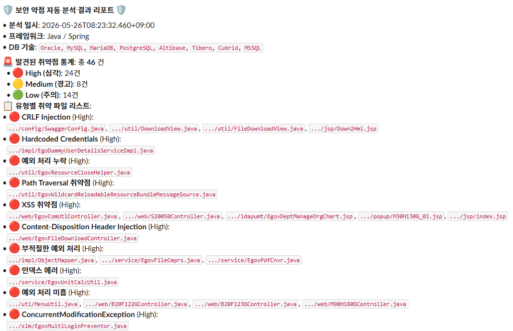

# codereview

로컬 LLM(Ollama)으로 소스코드의 보안 취약점을 찾아 주는 스크립트다. 결과는 JSON 리포트로 남기고, Slack으로 요약을 보낸다.

사내 코드를 외부 AI 서비스에 올리기는 부담스러워서, 코드가 밖으로 나가지 않도록 내 PC나 내부 서버에서 돌아가는 모델만 쓰게 만들었다.

## 구성

| 디렉터리 | 설명 |
|---|---|
| `code-reviewer/` | 분석 스크립트(`reviewer.js`) |
| `ollama-mcp-server/` | Ollama를 MCP 서버로 쓸 수 있게 해 주는 외부 오픈소스의 빌드본 (MIT). 분석 스크립트와는 별개다 |
| `docs/` | 실행 결과 화면 |

## 동작 순서

```
target_dir/ 의 소스코드
  │
  ├─ STEP 0    Ollama 서버 연결과 모델 설치 여부 확인. 실패하면 바로 종료
  ├─ STEP 1    파일 탐색
  ├─ STEP 1.5  pom.xml, application.yml 같은 설정 파일을 읽고 기술 스택 파악
  ├─ STEP 2    .java / .jsp / .sql 파일을 하나씩 분석
  │              ├─ 보안 관련 키워드가 하나도 없는 파일은 모델에 보내지 않음
  │              ├─ Ollama /api/chat 호출 (JSON 형식으로 응답, 실패 시 최대 3회 재시도)
  │              └─ 응답 형식 검사, 영어로만 답한 응답은 다시 요청
  │
  ├─ audit_report.json   취약점 리포트 (파일 하나 끝날 때마다 저장)
  ├─ analysis_debug.log  모델 원본 응답
  └─ Slack               심각도별 건수, 유형별 취약 파일 목록
```

### 만들면서 신경 쓴 부분

- 중간에 끊겨도 다시 실행하면 이미 분석한 파일은 건너뛰고 이어서 한다. 파일당 수십 초씩 걸려서 프로젝트가 크면 한 번에 끝내기 어렵다.
- 분석 대상은 프로젝트 구조를 보고 정한다. `src/main` 아래에 소스가 있는 Maven/Gradle 구조면 `src/main`만 보고, 그런 디렉터리가 없는 예전 구조(`src/com/...`, `WebContent/`)면 전체를 본다. 예전 구조에서는 `test` 같은 테스트 디렉터리를 기본으로 뺀다.
- 7B 모델은 가끔 형식을 무시하고 영어로 코드 설명을 늘어놓는다. 응답에 한글이 거의 없으면 다시 요청하도록 했다.
- 제일 조심한 건 "분석이 실패했는데 취약점 0건으로 보이는" 상황이다. 시작 전에 Ollama 연결부터 확인하고, 분석 대상이 0개이거나 모든 파일 분석이 실패하면 오류를 내고 종료 코드 `1`로 끝낸다.
- Slack 메시지는 4,000자 제한이 있어서 본문을 3,000자 안으로 자르고 생략한 건수를 따로 적는다.

## 준비

- [Node.js](https://nodejs.org) 20.6 이상 (`--env-file` 옵션을 쓴다)
- [Ollama](https://ollama.ai)

```bash
# Ollama를 먼저 켜 두고 (다른 터미널에서 계속 실행)
ollama serve

# 모델을 받는다. ollama serve가 켜져 있어야 받아진다
ollama pull qwen2.5-coder:7b
```

기본 설정은 RAM 16GB 노트북에 맞춰 뒀다. 한 번에 파일 하나씩만 처리하고(`CONCURRENCY_LIMIT = 1`), 컨텍스트 크기도 `num_ctx: 3072`로 작게 잡았다. 메모리가 넉넉하면 `reviewer.js`에서 두 값을 올리면 더 빨라진다.

## 실행

```bash
git clone https://github.com/kang30984/codereview.git
cd codereview

cp .env.example .env
# .env 에 SLACK_WEBHOOK_URL 등을 채운다

# 분석할 프로젝트를 target_dir 에 복사한다
cp -r /path/to/your-project/. code-reviewer/target_dir/

cd code-reviewer
node --env-file=../.env reviewer.js
```

복사할 때 `project/*`가 아니라 `project/.`로 써야 한다. `*`로 복사하면 최상위 폴더가 하나뿐일 때 폴더 한 단계가 사라져서 `src/main` 구조가 깨진다.

`reviewer.js`는 Node.js 기본 모듈과 `fetch`만 써서 `npm install` 없이 바로 돌아간다. `package.json`에 있는 LangChain 등의 의존성은 나중에 붙여 보려고 넣어 둔 것이고 지금 코드에서는 쓰지 않는다.

## 환경변수

| 변수 | 기본값 | 설명 |
|---|---|---|
| `SLACK_WEBHOOK_URL` | | Slack Incoming Webhook 주소. 비워 두면 알림을 보내지 않는다 |
| `OLLAMA_BASE_URL` | `http://localhost:11434` | Ollama 서버 주소 |
| `OLLAMA_MODEL` | `qwen2.5-coder:7b` | 분석에 쓸 모델 |
| `TARGET_DIR` | `./target_dir` | 분석할 디렉터리 |
| `REQUIRE_MAIN_PATH` | `auto` | `auto`는 구조를 보고 자동으로 정한다. `1`은 경로에 `main`이 있는 파일만, `0`은 전체를 분석한다 |
| `EXCLUDE_TEST_PATHS` | `1` | 예전 구조에서 테스트 디렉터리(`test`, `tests`, `testcase` 등)를 뺄지 여부 |
| `COPY_REPORT_TO_TARGET` | `0` | `1`이면 리포트를 `TARGET_DIR` 안에도 복사한다. 리포트에 코드 조각이 들어 있어서 기본은 복사하지 않는다 |
| `ALLOW_INSECURE_TLS` | `0` | `1`이면 TLS 인증서 검증을 끈다. 자체 서명 인증서를 쓰는 사내망에서만 쓴다 |

## 결과물

실행한 위치(`code-reviewer/`)에 아래 파일이 생긴다. 모두 `.gitignore`에 들어 있다.

| 파일 | 내용 |
|---|---|
| `audit_report.json` | 분석 시각, 기술 스택, 통계(`summary`), 취약점 상세(유형, 심각도, 라인, 설명, 수정 방법) |
| `analysis_status.log` | 단계별 진행 로그. 실행할 때마다 구분선을 넣고 이어서 쓴다 |
| `analysis_debug.log` | 파일별 모델 원본 응답 |

리포트를 볼 때는 `summary`부터 확인해야 한다. `vulnerabilities`가 비어 있어도 `error`가 많으면 그만큼 검사를 못 한 것이고, 취약점이 없다는 뜻이 아니다.

| 항목 | 의미 |
|---|---|
| `vulnerableFiles` | 취약점이 나온 파일 수 |
| `safe` | 모델이 보고 취약점이 없다고 한 파일 수 |
| `error` | 분석 실패 (응답 파싱 실패, 타임아웃 등). 검사되지 않음 |
| `skippedBySize` | 파일이 너무 커서 뺀 수 (`.java` 250KB, `.jsp` 150KB, 그 외 100KB 초과). 검사되지 않음 |
| `skippedByTriage` | 보안 관련 키워드가 없어서 모델에 보내지 않은 수. 모델이 보지 않음 |

다섯 값을 더하면 `totalTargets`가 된다.

### 리포트 예시

```json
{
  "analyzedAt": "2026-05-26T08:23:32.460+09:00",
  "summary": {
    "totalTargets": 412,
    "vulnerableFiles": 37,
    "safe": 310,
    "error": 5,
    "skippedBySize": 2,
    "skippedByTriage": 58
  },
  "framework": {
    "language": "Java",
    "framework": "Spring",
    "dbTechnology": "Oracle, MySQL, MariaDB",
    "summary": "..."
  },
  "vulnerabilities": [
    {
      "fileName": "src/main/java/.../EgovComUtl1Controller.java",
      "vulnerable": true,
      "vulnerabilityTypes": {
        "XSS 취약점": [
          {
            "severity": "High",
            "location": "142",
            "analysis": "사용자 입력값을 검증 없이 응답에 출력합니다.",
            "fixedCode": "출력 시 HTML 이스케이프 처리를 적용합니다. ..."
          }
        ]
      }
    }
  ]
}
```

### Slack 알림 예시



## 알아 둘 점

- 파일은 앞에서부터 1만 자까지만 모델에 보낸다. 7B 모델과 16GB 메모리에서 돌리려고 줄인 것이라, 그보다 긴 파일은 뒷부분이 분석되지 않는다.
- 영어로만 답하는 응답이 재시도 끝까지 이어지면 그 파일은 `safe`로 기록된다. `analysis_debug.log`에 `hallucination_fallback_safe`로 남으니, 의심되면 이 로그에서 찾아보면 된다.
- 키워드 사전 필터는 처리 시간을 줄이려는 것이라 놓치는 경우가 있을 수 있다.
- 로컬 7B 모델이라 오탐과 미탐이 꽤 있다. 결과는 사람이 확인할 목록으로 보는 게 맞다.

## 자주 막히는 곳

| 증상 | 해결 |
|---|---|
| `Ollama 서버에 연결할 수 없습니다` | 다른 터미널에서 `ollama serve`를 실행한다. 원격 서버면 `OLLAMA_BASE_URL`을 확인한다 |
| `모델 '...' 을 찾을 수 없습니다` | `ollama pull qwen2.5-coder:7b`로 받는다. 다른 모델을 쓰려면 `OLLAMA_MODEL`을 바꾼다 |
| `분석 대상 파일이 0개입니다` | `target_dir`에 `.java`/`.jsp`/`.sql` 파일이 있는지 확인한다. `REQUIRE_MAIN_PATH=1`로 강제했다면 지우거나 `auto`로 바꾼다 |
| `cp: target 'code-reviewer/target_dir/': No such file or directory` | `mkdir -p code-reviewer/target_dir`로 만든 뒤 다시 복사한다 |
| 복사했는데 파일이 안 잡힌다 | `project/*`로 복사해서 폴더 한 단계가 사라졌을 가능성이 크다. `target_dir`를 비우고 `project/.`로 다시 복사한다 |
| 모든 파일이 실패했다는 메시지 | 모델 응답을 하나도 받지 못한 상태다. `analysis_debug.log`의 `error`를 본다. 이때 리포트의 취약점 0건은 안전하다는 뜻이 아니다 |
| 너무 느리다 | 7B 모델이면 파일당 수십 초 걸리는 게 보통이다. 메모리가 넉넉하면 `CONCURRENCY_LIMIT`을 올린다 |
| 중간에 끊겼다 | 다시 실행하면 이어서 할지 묻는다. `y`(기본값)면 이어서, `n`이면 처음부터 한다 |

종료 코드는 정상 완료면 `0`, Ollama 연결이나 모델 확인 실패, 분석 대상 0개, 전체 분석 실패면 `1`이다. CI에 붙일 때 이걸로 실패를 판단하면 된다.

## ollama-mcp-server

[hyzhak/ollama-mcp-server](https://github.com/hyzhak/ollama-mcp-server)(MIT, 원작 [NightTrek/Ollama-mcp](https://github.com/NightTrek/Ollama-mcp))의 빌드 결과물(`build/index.js`)만 들어 있다. TypeScript 소스가 없어서 이 폴더에서 `npm install`이나 `npm run build`는 안 된다. Claude Desktop 같은 MCP 클라이언트에서 Ollama를 쓰고 싶다면 아래처럼 npx로 설치해서 쓰는 편이 낫다.

```json
{
  "mcpServers": {
    "ollama": {
      "command": "npx",
      "args": ["ollama-mcp-server"]
    }
  }
}
```

자세한 내용은 [`ollama-mcp-server/README.md`](ollama-mcp-server/README.md)에 있다.

## 보안 관련

- `.env`는 커밋하지 않는다. Webhook 주소 같은 값은 전부 환경변수로만 넣는다.
- `target_dir/`는 `.gitignore`에 들어 있다. 분석하려고 넣은 사내 코드가 실수로 공개 저장소에 올라가지 않게 하기 위해서다.
- `audit_report.json`에는 취약점 위치와 코드 조각이 들어 있으니 외부에 공유하지 않는다.
- `ALLOW_INSECURE_TLS=1`은 TLS 검증을 끄기 때문에 중간자 공격에 노출된다. 믿을 수 있는 내부망에서만 쓴다.

## 라이선스

- `code-reviewer/`: ISC
- `ollama-mcp-server/`: MIT (원저작자 표기는 해당 폴더의 `LICENSE`)
